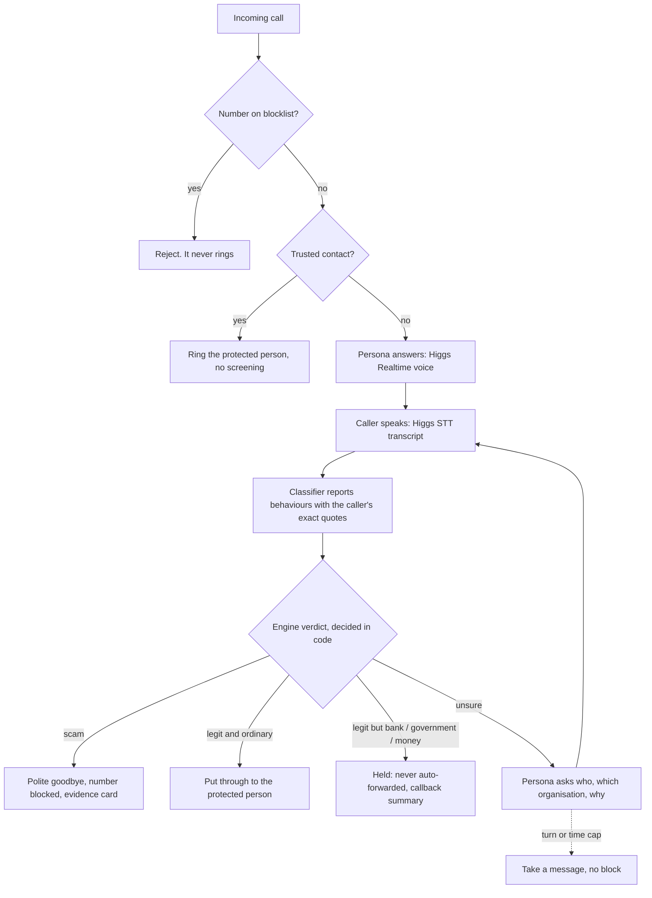

# Hang On — AI Call Screening

**A real-time voice AI prototype that screens unknown callers, identifies suspicious behaviour, and hands approved calls to a human receiver.**

Alexander Menassa and Baiwei Zhong · Boson AI × MScAC Hackathon · Toronto · October 2026

**Python · asyncio · Higgs Realtime · Gemini / Ollama · WebRTC / aiortc · SQLite · pytest · GitHub Actions**

[Quick start](#quick-start) · [Technical decisions](#technical-decisions) · [Full setup](QUICK_SETUP.md)

## Why Hang On?

Number-based blockers cannot assess what a caller is asking someone to do. Hang On answers unknown calls with a configurable persona—our demo uses **Walter, an 88-year-old retired machinist**—while a separate classifier extracts suspicious behaviours. A Python engine controls routing and blocking independently of generated speech.

**Hackathon prototype:** phone numbers and SMS are simulated; browser calls use real microphone audio.

## Demo

| Receiver controls | Unknown caller screened | Approved call rings receiver |
| --- | --- | --- |
|  |  |  |

## How a call flows



**Higgs speaks, the classifier assesses, code decides.** Unknown callers cannot be forwarded by the conversational model itself. Detected prompt-steering attempts prevent automatic forwarding; uncertainty alone does not block a number.

## Technical decisions

| Decision | Implementation and benefit |
| --- | --- |
| **Separate models from routing authority** | The classifier reports behaviours; code computes scores and actions. Hard cues such as threats can trigger a scam verdict; urgency or authority claims alone cannot. |
| **Ground classifier output in speech** | Validate JSON, behaviour types, supporting quote words, and extracted evidence against the caller transcript before scoring. Lexical checks reject unsupported output but do not prove semantic correctness. |
| **Classify in the background** | An `asyncio` pipeline runs classification in a worker thread while the persona continues screening. Stale results cannot authorize forwarding after newer speech; obsolete queued turns are skipped. Used in browser and terminal voice modes. |
| **Control the audio lifecycle** | An explicit gateway manages ringing, acceptance, timeouts, and idempotent events. An `aiortc` WebRTC bridge detaches Higgs before human audio; bounded, sample-clock-paced buffers limit stale playback. |
| **Make behavior testable offline** | Shared provider interfaces, fake servers, synthetic audio, and isolated SQLite stores support repeatable regression checks without API keys. |

## Quick start

Python 3.12; no API keys needed for the offline simulator.

```bash
git clone https://github.com/vito-zbw/BosonAI-Hackathon.git
cd BosonAI-Hackathon
python3 -m venv .venv
source .venv/bin/activate
pip install -r requirements.txt

python -m hangon.sim --db demo.db --scenario scenarios/cra_scam.txt --number +14165550111
python -m hangon.sim --db demo.db --scenario scenarios/pharmacy_legit.txt --number +14165550222
python -m hangon.sim --db demo.db --scenario scenarios/cra_scam.txt --number +14165550111
```

On Windows PowerShell, activate with `.venv\Scripts\Activate.ps1`.

Expected outcomes: **scam ended and blocked → ordinary call approved → repeated scammer rejected**. Terminal forwarding is simulated. Evidence reports include the screening transcript, extracted details, verdict, and classifier source.

### Live voice and browser

Copy `.env.example` to `.env` and set your own `BOSON_API_KEY` and `GEMINI_API_KEY`.

```bash
python -m hangon.voice --classifier gemini
python -m hangon.server --port 8765
```

For the browser demo, open **http://127.0.0.1:8765/** in separate caller and receiver sessions, join the same room, and place a call. Use headphones. Live modes use provider credits.

Gemini, local Ollama, and heuristic classifiers share one interface. Set `HANGON_CLASSIFIER=heuristic` to omit Gemini from browser screening; voice still requires Boson. Configure the persona in [models.py](hangon/models.py) and its voice with `HIGGS_VOICE`.

See [full setup](QUICK_SETUP.md) and [HTTPS / TURN configuration for two devices](docs/PHASE-2B-SETUP.md).

## Testing

```bash
python scripts/verify.py
```

**Verified November 14, 2026: 207 offline tests passed, plus isolated CLI outcome checks.** Coverage includes grounding, provider failures, stale classifications, call-state transitions, persistence, fake Higgs sessions, and synthetic audio. GitHub Actions runs the same verification on pushes and pull requests.

The repository includes **nine scripted scenarios** and **eight adaptive caller briefs**. To run Gemini-driven callers against the agent (requires credits):

```bash
python -m hangon.redteam --all --agent scripted
```

These are synthetic development checks, not evidence of real-world scam-detection accuracy. Live providers and physical-browser audio were not verified in the reported run.

## Code guide

| Area | Source |
| --- | --- |
| Routing and lifecycle | [engine.py](hangon/engine.py), [gateway.py](hangon/gateway.py), [rules.py](hangon/rules.py) |
| Classification and concurrency | [classifier.py](hangon/classifier.py), [pipeline.py](hangon/pipeline.py) |
| Voice and browser media | [voice.py](hangon/voice.py), [browser/](hangon/browser/), [web/](web/) |
| Persistence and evidence | [store.py](hangon/store.py), [reports.py](hangon/reports.py) |
| Verification | [tests/](tests/), [verify.py](scripts/verify.py), [development notes](docs/HARNESS.md) |

## Limits and next steps

- **No telephone-network or SMS integration.** Trusted numbers bypass screening, and caller ID is not identity verification.
- **No measured field accuracy.** Rule-derived scores are not calibrated probabilities; broader languages, accents, and adversarial calls need evaluation.
- **Hosted processing:** Gemini receives transcripts; Ollama keeps classification local, but Higgs voice still uses a hosted provider. Stored transcripts need retention and access controls.
- **Next:** real telephony integration, live latency and detection evaluation, broader two-device/TURN checks, and dependency locking.

Further implementation tradeoffs are recorded in [design decisions](docs/decisions/).
