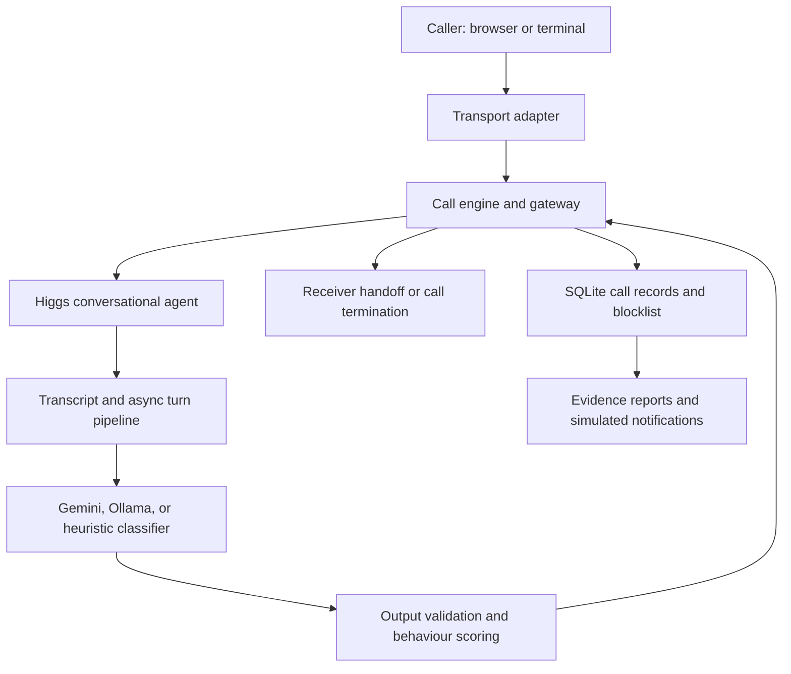

# Hang On — Real-Time AI Call Screening

**A voice AI prototype that screens unknown callers before they reach an older adult, explains suspicious behaviour with transcript-backed evidence, and hands approved calls to a human receiver.**

Built by **Alexander Menassa and Baiwei Zhong** at the **Boson AI × MScAC Hackathon**, Toronto, October 2026.

**Python 3.12 · asyncio · Higgs Realtime · Gemini / Ollama · WebRTC / aiortc · WebSockets · SQLite · pytest · GitHub Actions**

[Try it locally](#quick-start-no-api-keys) · [Engineering decisions](#engineering-decisions) · [Architecture](#architecture) · [Testing](#testing-and-evaluation) · [Setup guide](QUICK_SETUP.md)

## The problem

A number-based call blocker cannot assess what a caller is asking someone to do. Hang On adds a conversational screening layer: a configurable persona answers unknown callers, a separate classifier extracts suspicious behaviours, and a Python decision engine controls routing, blocking, and call termination.

The sample persona is **Walter**, an 88-year-old retired machinist. Persona configuration is separate from routing policy, so changing the character does not change the decision rules.

**Prototype scope:** browser and terminal calls use simulated phone numbers. Real telephone-network integration and SMS delivery are not implemented.

## See the experience

| Receiver controls | Unknown caller screening | Trusted caller handoff |
| --- | --- | --- |
|  |  |  |

The browser demo supports separate caller and receiver roles, microphone audio, screening captions, trust/block lists, and an accepted human-to-human audio handoff.

## Engineering decisions

| Decision | Implementation | Why it matters |
| --- | --- | --- |
| **Separate conversation from control** | Higgs speaks; the classifier reports behaviours; the engine computes verdicts and routing actions. | A conversational model cannot directly transfer a call, block a number, or hang up. Policy can be tested independently of generated speech. |
| **Validate model output against caller speech** | Parse structured JSON, allow only known behaviour types, check supporting quote words against the caller transcript, and validate extracted evidence. | Rejects unsupported model output before it influences scoring. This is a lexical grounding check, not a guarantee of semantic correctness. |
| **Keep classification off the conversational critical path** | An `asyncio` turn pipeline runs classification in a worker thread. After a configurable grace period, the agent can continue screening while the result is pending. | Avoids waiting for the entire classifier request on every reply; older transcript results cannot authorize a handoff after newer speech arrives. |
| **Model the call lifecycle explicitly** | A transport-independent engine and gateway coordinate screening, ringing, connection, completion, timeouts, and idempotent commands. | Keeps routing consistent across transports and prevents late events from reviving ended calls. |
| **Own the audio handoff** | WebRTC peers connect through an `aiortc` media bridge; the gateway detaches screening before enabling human audio. | Separates approval to ring from successful connection and handles media failures explicitly. |
| **Test without live providers** | Scripted scenarios, fake provider servers, synthetic audio, and isolated SQLite stores exercise the core logic. | Makes regression checks repeatable without API keys or paid inference. |

### Real-time audio details

The voice adapters handle speech detection, interruptions, playback cancellation, and provider conversation truncation. Browser playback is paced against a monotonic sample clock; queued audio is bounded by duration, with a smaller buffer for the human-to-human route. These choices address playback drift and stale audio rather than relying on an unbounded queue.

The shared background-classification pipeline is wired into **both terminal voice and browser screening**. Late forward/end decisions are applied through the call controller after the current screening reply finishes.

## Architecture



### Routing policy

- **Blocked number:** reject before screening; blocking takes priority over trust.
- **Trusted number:** ring the receiver directly without AI screening. This is a demo convenience, not identity verification.
- **Unknown number:** screen until the engine approves an ordinary call, identifies scam behaviour, or reaches the conversation limit.
- **High-stakes unknown caller:** money, banking, or government claims are not auto-forwarded, even when classified as legitimate; provide a callback summary instead.
- **Uncertain call:** take a message when the cap is reached; uncertainty alone does not block a number.
- **Detected prompt-steering attempt:** prevent automatic forwarding. Regex checks supplement the model prompt; they are not comprehensive prompt-injection protection.

Hard behaviours such as payment demands, threats, secrecy, and requests for credentials can trigger a scam verdict. Soft cues such as urgency or claiming authority raise suspicion but cannot reach the scam threshold alone. Scores are rule-derived, **not calibrated probabilities**.

## Quick start: no API keys

Use Python 3.12. The offline simulator runs the real engine with a scripted agent and heuristic classifier.

```bash
git clone https://github.com/vito-zbw/BosonAI-Hackathon.git
cd BosonAI-Hackathon
python3 -m venv .venv
source .venv/bin/activate
pip install -r requirements.txt
```

On Windows PowerShell, activate with `.venv\Scripts\Activate.ps1`.

Run three contrasting scenarios using a separate demo database:

```bash
python -m hangon.sim --db demo.db --scenario scenarios/cra_scam.txt --number +14165550111
python -m hangon.sim --db demo.db --scenario scenarios/pharmacy_legit.txt --number +14165550222
python -m hangon.sim --db demo.db --scenario scenarios/cra_scam.txt --number +14165550111
```

| Scenario | Expected offline outcome |
| --- | --- |
| Fake CRA caller escalates to an arrest threat | End the call, block the number, and write an evidence card. |
| Pharmacy calls about prescription pickup | Approve forwarding without blocking. In the terminal this is a simulated handoff. |
| Same blocked caller tries again | Reject before the agent answers. |

For an interactive text call, run `python -m hangon.sim --db demo.db --number +14165550444`. Reports include the outcome, classifier source, extracted evidence, and screening transcript.

## Live voice and browser demo

Copy `.env.example` to `.env` and configure your own credentials. **Live calls consume provider credits.**

| Mode | Requirements | Start command |
| --- | --- | --- |
| Terminal microphone call | Boson key; Gemini key when selecting Gemini; microphone and speakers | `python -m hangon.voice --classifier gemini` |
| Browser caller/receiver | Boson key for unknown-caller screening; Gemini key by default | `python -m hangon.server --port 8765` |
| Offline simulator | No keys | `python -m hangon.sim` |

For the browser, open **http://127.0.0.1:8765/** in two separate browser sessions. Create a room as caller, join it as receiver, and place a call from a simulated number. The receiver can manage lists and accept an approved call. Use headphones.

Set `HANGON_CLASSIFIER=heuristic` to run browser classification without Gemini; unknown-caller voice screening still requires Boson. Hosted Gemini and local Ollama adapters share the same assessment contract. The browser treats provider fallback/failure as unavailable screening rather than permission to forward or block.

Two physical devices need a shared HTTPS origin for microphone access and may require a TURN relay. See the [setup guide](QUICK_SETUP.md) and [two-device configuration](docs/PHASE-2B-SETUP.md).

### Persona and voice configuration

The sample persona's name, age, and backstory live in [`Persona`](hangon/models.py). The terminal also accepts `--persona-name`. Set `HIGGS_VOICE` to a preset or registered voice ID; the current browser and terminal paths both pass the configured voice to Higgs. [`hangon.voices`](hangon/voices.py) provides reference-clip registration utilities.

## Testing and evaluation

```bash
python scripts/verify.py
```

**Verification snapshot (November 14, 2026): 207 tests passed, along with all isolated CLI checks.** This run used offline fixtures; live provider and physical-browser checks were not run.

The shared verification command runs the pytest suite, then checks persisted outcomes for a scam call, an ordinary call, an uncertain call, and a repeated blocked caller in an isolated temporary database. GitHub Actions runs the same command on pushes and pull requests and uploads a verification summary.

The tests cover:

- Behaviour scoring, quote grounding, malformed model output, and provider fallback.
- High-stakes and injection checks, trust/block precedence, and call persistence.
- Slow classification, stale verdicts, dropped obsolete turns, and results arriving after hang-up.
- Gateway state transitions, duplicate events, unavailable receivers, and timeouts.
- Fake Higgs protocol exchanges, synthetic two-way audio, buffering, and interruption handling.

The repository also includes **nine scripted call scenarios** and **eight adaptive caller briefs**. The optional red-team harness uses Gemini to play callers that respond to the agent rather than replaying fixed lines:

```bash
python -m hangon.redteam --all --agent scripted
```

This requires Gemini credits. Its outcome checks are development diagnostics on synthetic calls, **not a real-world scam-detection benchmark**. A passing offline suite does not validate live provider timing, physical-device audio quality, or population-level accuracy.

## Code guide

| Area | Entry points |
| --- | --- |
| Policy and call lifecycle | [`engine.py`](hangon/engine.py), [`rules.py`](hangon/rules.py), [`gateway.py`](hangon/gateway.py) |
| Classifier adapters, grounding, and scoring | [`classifier.py`](hangon/classifier.py) |
| Background turn processing | [`pipeline.py`](hangon/pipeline.py) |
| Realtime voice and persona | [`voice.py`](hangon/voice.py), [`agent.py`](hangon/agent.py), [`persona.py`](hangon/persona.py), [`voices.py`](hangon/voices.py) |
| Browser signaling and media | [`browser/server.py`](hangon/browser/server.py), [`browser/media.py`](hangon/browser/media.py), [`web/`](web/) |
| Persistence and reporting | [`store.py`](hangon/store.py), [`reports.py`](hangon/reports.py), [`notify.py`](hangon/notify.py) |
| Simulation and evaluation | [`sim.py`](hangon/sim.py), [`redteam.py`](hangon/redteam.py), [`scenarios/`](scenarios/), [`tests/`](tests/) |
| Repeatable verification | [`scripts/verify.py`](scripts/verify.py), [GitHub Actions](.github/workflows/verify.yml) |

## Limitations and next steps

- **Prototype, not a telephone service:** numbers, telephone-network entry, and SMS/guardian delivery are simulated. Browser audio is real microphone audio, but the app does not intercept an existing phone number.
- **Evaluation scope:** synthetic scenarios do not establish field accuracy. Broader calls, accents, languages, and adversarial testing are needed; the current experience is English-first.
- **Privacy:** Gemini receives transcripts when selected. Local Ollama keeps classification local, but live Higgs speech still uses a hosted provider. SQLite records and report files contain conversation data.
- **Known tradeoffs:** lexical grounding cannot establish that a quote supports the model's interpretation. Caller ID can be spoofed. The current trusted-number bypass does not screen high-stakes requests.
- **Next engineering work:** integrate a telephony provider, measure live latency and false-positive/negative rates, validate TURN and two-device behavior on target networks, harden data retention/access controls, and lock dependencies for reproducible installs.

See [development verification notes](docs/HARNESS.md) and [design decisions](docs/decisions/). Historical planning notes may describe earlier implementation states; the source and tests establish current behavior.
